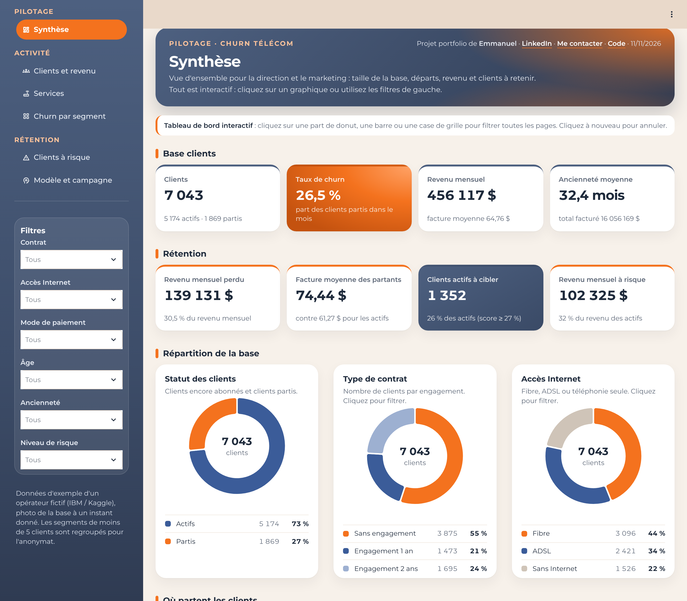
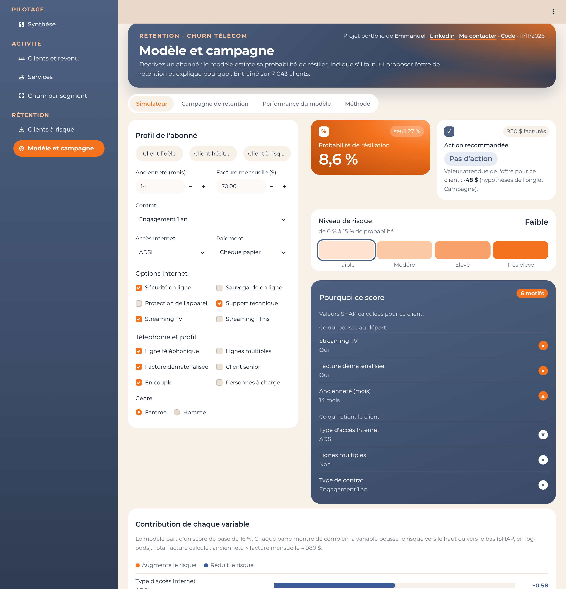
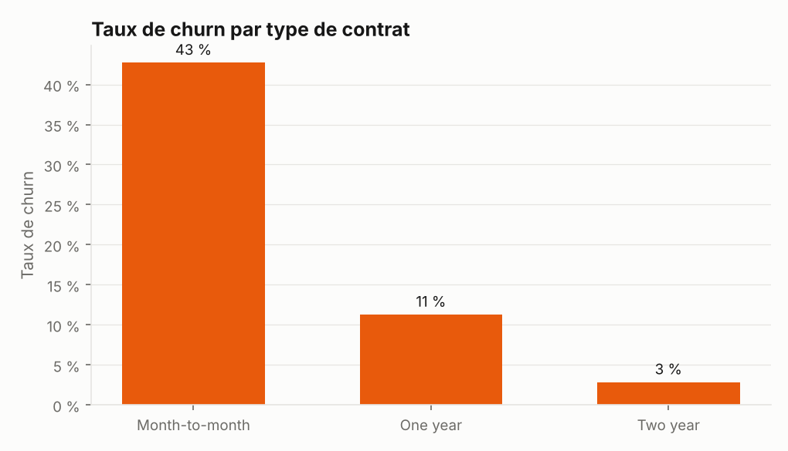
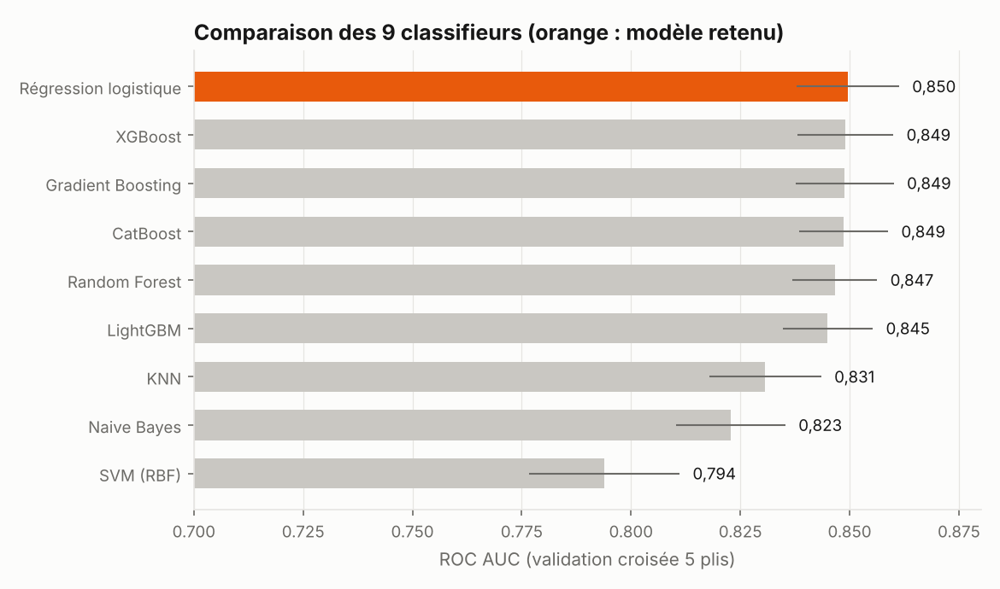
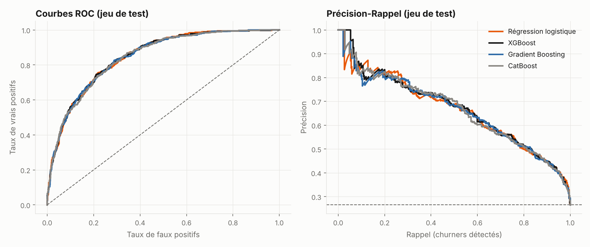
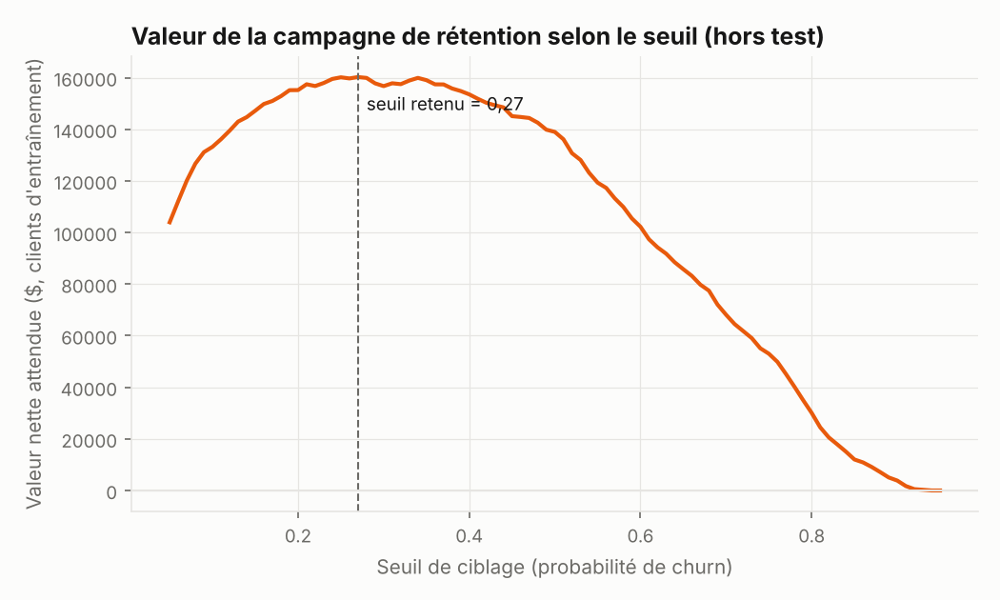
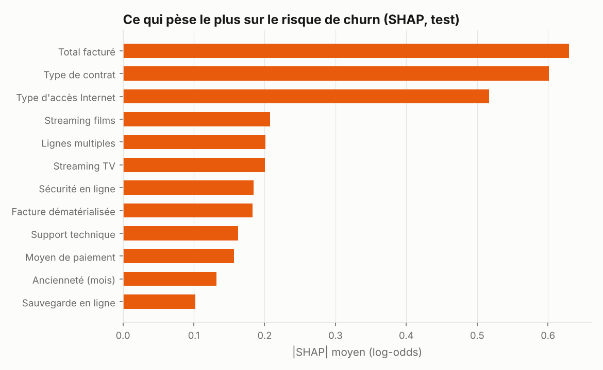
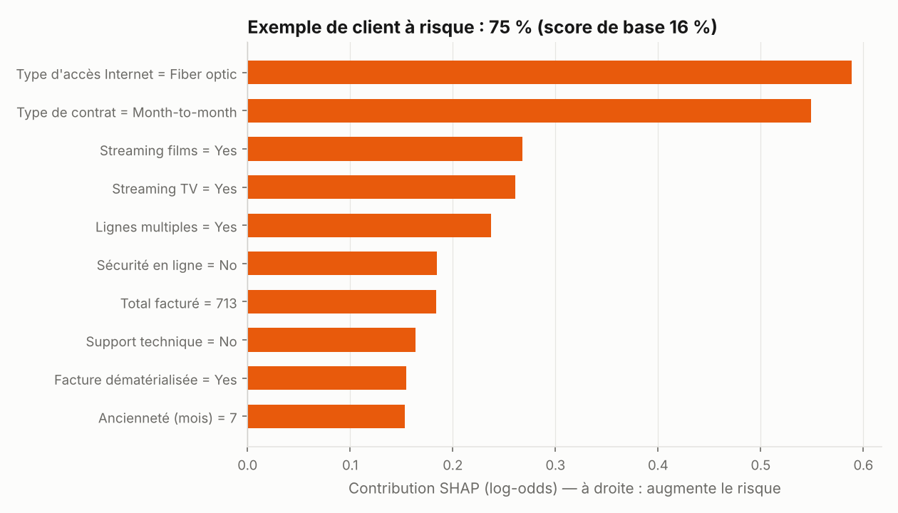

# Telco Churn Prediction : qui va résilier, et faut-il agir ?

[](https://github.com/mremmanuelgakpe-coding/telco-churn-prediction/actions/workflows/ci.yml)

> **Projet 5 du portfolio Data & IA, variante télécoms : modélisation prédictive avec un classifieur**
> Problématique : *quels clients risquent de se désabonner, et lesquels faut-il cibler avec une offre de rétention ?*

Les neuf classifieurs du sujet sont comparés sur 7 043 abonnés. Le seuil de ciblage est choisi pour **maximiser la valeur d'une campagne de rétention**, et chaque score est accompagné de ses **motifs (SHAP)**. Le modèle est servi par une **API FastAPI sécurisée** dans **Docker**, avec un **tableau de bord Streamlit** de six pages : pilotage et activité pour le marketing et la direction, rétention et modèle pour l'équipe data.

| | Résultat (jeu de test, 1 409 clients jamais vus) |
|---|---|
| Modèle retenu | **Régression logistique** |
| ROC AUC / PR-AUC | **0,848 / 0,664** (taux de churn de base : 26,5 %) |
| Les 20 % de clients les plus risqués | concentrent **51 %** des départs (lift × 2,56) |
| Au seuil retenu (27 %) | **79 %** des départs détectés en ciblant 42 % de la base |
| Valeur de la campagne simulée | **35 974 $** contre 7 672 $ en ciblant tout le monde |

### Démo en ligne : [lien Streamlit à ajouter après déploiement](#lancer-le-projet)



Le tableau de bord est une seule application, organisée comme le projet 2 : menu latéral par sections, filtres globaux à gauche, cartes KPI de même taille, grilles et donuts.

| Section | Page | Contenu |
|---|---|---|
| Pilotage | **Synthèse** (accueil) | 8 KPI (clients, churn, revenu, ancienneté, revenu perdu, clients à cibler…), donuts statut / contrat / Internet, churn par contrat et par ancienneté, points d'attention calculés |
| Activité | **Clients et revenu** | revenu, facture moyenne, profil des abonnés, mode de paiement, ancienneté, revenu conservé et perdu |
| Activité | **Services** | téléphonie, accès Internet, grille des 6 options (adoption, churn avec et sans), croisements contrat × Internet |
| Activité | **Churn par segment** | grilles de churn contrat × ancienneté, paiement × contrat, âge × Internet, classement des segments les plus exposés |
| Rétention | **Clients à risque** | clients actifs à cibler, revenu à risque, portefeuille par niveau de risque, localisation des cibles |
| Rétention | **Modèle et campagne** | simulateur d'un client avec motifs SHAP, campagne réglable, performance, méthode |

**Filtrage croisé, comme dans Power BI** : un clic sur une part de donut, une barre ou une case de grille filtre toutes les pages. Le graphique cliqué garde toutes ses modalités et met la sélection en avant. Un second clic annule. Les filtres actifs s'affichent en puces, chacune avec une croix pour la retirer. Ils sont synchronisés avec les 6 filtres de la barre latérale (contrat, accès Internet, paiement, âge, ancienneté, niveau de risque), qui permettent aussi de choisir plusieurs valeurs.

Les KPI des pages d'activité sont calculés à partir d'un **cube agrégé k-anonyme** (`reports/activity/`, aucun segment de moins de 5 clients, aucune ligne client), généré par `python -m telco_churn.activity`.



---

## 1. Contexte et objectif

Dans les télécoms, garder un client coûte bien moins cher que d'en conquérir un nouveau. Mais une offre de rétention a un coût : la proposer à tout le monde gaspille le budget, et ne la proposer à personne laisse partir les clients. L'objectif est double :

1. **estimer la probabilité de résiliation** de chaque abonné ;
2. **décider qui cibler**, en arbitrant le coût de l'offre et le revenu sauvé.

## 2. Données

[Telco Customer Churn](https://www.kaggle.com/datasets/blastchar/telco-customer-churn) : jeu d'exemple d'IBM republié sur Kaggle, 7 043 clients, 19 variables (profil, services souscrits, contrat, facturation), cible `Churn` = résiliation dans le dernier mois. Licence indiquée : « Data files © Original Authors ». Le fichier brut n'est donc **pas** republié ici ; [`data/README.md`](data/README.md) explique comment le télécharger.



**Nettoyage** (`src/telco_churn/data.py`) : `TotalCharges` est stocké en texte et vide pour les 11 clients arrivés dans le mois (ancienneté 0), qui n'ont encore rien payé ; il est mis à 0. Aucun identifiant dupliqué. Vingt-deux profils identiques correspondent à des clients différents et sont conservés.

## 3. Méthodologie

```
7 043 clients
 ├── 80 % entraînement ── validation croisée stratifiée 5 plis
 │                         ├─ comparaison des 9 modèles (AUC, PR-AUC, Brier, lift)
 │                         └─ seuil de ciblage choisi sur les prédictions out-of-fold
 └── 20 % test ─────────── évaluation finale, utilisée une seule fois
```

Prétraitement dans un `Pipeline` scikit-learn (standardisation, log de `TotalCharges`, one-hot), ajusté uniquement sur les plis d'entraînement.



| Modèle | AUC (CV) | PR-AUC (CV) | Lift top 20 % (CV) | AUC (test) |
|---|---|---|---|---|
| **Régression logistique** | **0,850 ± 0,012** | 0,671 | 2,56 | 0,848 |
| XGBoost | 0,849 ± 0,011 | 0,668 | 2,54 | 0,848 |
| Gradient Boosting | 0,849 ± 0,011 | 0,666 | 2,54 | 0,846 |
| CatBoost | 0,849 ± 0,010 | 0,667 | 2,53 | 0,845 |
| Random Forest | 0,847 ± 0,010 | 0,659 | 2,54 | 0,843 |
| LightGBM | 0,845 ± 0,010 | 0,660 | 2,50 | 0,845 |
| KNN | 0,831 ± 0,013 | 0,615 | 2,44 | 0,823 |
| Naive Bayes | 0,823 ± 0,013 | 0,619 | 2,46 | 0,812 |
| SVM (RBF) | 0,794 ± 0,017 | 0,636 | 2,53 | 0,798 |

**Lecture.** Les six premiers modèles sont dans un mouchoir de poche : leurs écarts (0,005 d'AUC au plus) sont plus petits que leur variabilité d'un pli à l'autre (± 0,011). Ils sont statistiquement équivalents. La **régression logistique** est retenue : elle est en tête, simple, rapide, et ses explications sont directement lisibles. Sur ce jeu de données tabulaire et peu volumineux, le boosting n'apporte rien de plus. Le SVM est le moins bon pour classer, mais garde un bon lift sur les 20 % les plus risqués.



## 4. Du score à l'action : la campagne de rétention

Le seuil de 0,5 n'a aucun sens métier. On simule une campagne avec des hypothèses **explicites et réglables** (`config.py` et l'onglet « Campagne » de la démo) :

- un client ciblé reçoit une offre valant **1 mois** de son abonnement ;
- si c'est un vrai « churner », l'offre le retient avec une probabilité de **30 %** ;
- un client retenu rapporte **12 mois** de revenus supplémentaires.

Valeur nette = Σ churners ciblés × 30 % × 12 × facture − Σ clients ciblés × 1 × facture. Le seuil qui la maximise sur les prédictions *out-of-fold* (jamais sur le test) vaut **27 %**.



| Sur le jeu de test (1 409 clients) | Valeur |
|---|---|
| Clients ciblés | 586 (42 %) |
| Départs détectés | 296 / 374 (79 %), précision 51 % |
| Valeur nette | **35 974 $** |
| En ciblant tout le monde | 7 672 $ |
| En ne ciblant personne | 0 $ |

La courbe est plate entre 20 % et 45 % : le choix exact du seuil compte moins que le fait de cibler. L'optimum calculé a posteriori sur le test (33 %, 38 435 $) n'est affiché qu'à titre d'information.

## 5. Explicabilité : pourquoi ce client va partir

Chaque score est décomposé en **valeurs SHAP exactes**. Pour la régression logistique, la contribution d'une variable vaut coefficient × (valeur − moyenne d'entraînement) ; pour XGBoost, LightGBM et CatBoost, on utilise le TreeSHAP natif de chaque bibliothèque. Les colonnes one-hot sont regroupées sur les variables d'origine. La somme des contributions retrouve exactement la probabilité du modèle, ce que vérifie un test.

<p float="left">


</p>

Les grands moteurs du churn sont le **type de contrat** (43 % de départs sans engagement contre 3 % avec un engagement de 2 ans), l'**accès Internet par fibre** et l'**ancienneté**. Cette dernière apparaît surtout à travers le total facturé, qui lui est très lié. Les options de sécurité et de support technique retiennent les clients.

## 6. API de prédiction (FastAPI)

| Méthode | Route | Rôle | Auth |
|---|---|---|---|
| GET | `/health` | Sonde de vie | non |
| GET | `/model-info` | Modèle, seuil, hypothèses de campagne, métriques | clé API |
| POST | `/predict` | Probabilité, action recommandée, niveau de risque, motifs | clé API |
| POST | `/predict/batch` | Lot de clients (≤ 500), motifs avec `?explain=true` | clé API |

```bash
curl -X POST http://localhost:8000/predict -H "X-API-Key: $API_KEY" -H "Content-Type: application/json" -d '{
  "tenure": 3, "MonthlyCharges": 95.0, "TotalCharges": 285.0, "SeniorCitizen": 1, "gender": "Female",
  "Partner": "No", "Dependents": "No", "PhoneService": "Yes", "MultipleLines": "Yes",
  "InternetService": "Fiber optic", "OnlineSecurity": "No", "OnlineBackup": "No", "DeviceProtection": "No",
  "TechSupport": "No", "StreamingTV": "Yes", "StreamingMovies": "Yes", "Contract": "Month-to-month",
  "PaperlessBilling": "Yes", "PaymentMethod": "Electronic check"}'
```

La réponse contient `churn_probability`, `action` (`RETENTION_OFFER` ou `NO_ACTION`), `risk_band` et `explanation` (facteurs qui poussent au départ et facteurs qui retiennent le client, avec leur contribution SHAP).

### Sécurité

| Risque | Mesure |
|---|---|
| Accès non autorisé | Clé API `X-API-Key`, comparaison à temps constant ; refus si aucune clé n'est configurée |
| Entrées invalides ou incohérentes | Schéma Pydantic strict (valeurs autorisées, bornes, champs inconnus refusés) **et contrôle de cohérence** : pas d'options Internet sans Internet, pas de lignes multiples sans téléphone |
| Artefact modifié (joblib = pickle) | Empreinte SHA-256 vérifiée avant chargement |
| Données personnelles | Aucun contenu de requête journalisé ; `Cache-Control: no-store` ; données brutes hors Git et hors image |
| Surface d'attaque | Documentation désactivée par défaut ; lots plafonnés ; en-tête serveur masqué |
| Conteneur | Utilisateur non-root, code en lecture seule, `--read-only`, `--cap-drop ALL`, `no-new-privileges` |

## Lancer le projet

```bash
make install        # environnement + dépendances (Python 3.11+)
make train          # entraîne et compare les 9 modèles, écrit models/ et reports/
make test           # 29 tests : nettoyage, campagne, API, sécurité, SHAP, démo
make demo           # tableau de bord Streamlit (ou double-clic sur lancer_demo.command sous macOS)
cp .env.example .env && make api          # API sur http://localhost:8000
make docker-build && make docker-run
```

**Démo en ligne** sur [Streamlit Community Cloud](https://share.streamlit.io) : dépôt, branche `main`, fichier `demo/app.py`, Python 3.12. Les dépendances sont lues dans `demo/requirements.txt`. La démo charge le modèle directement, sans clé, et n'enregistre aucune saisie.

## Structure

```
telco-churn-prediction/
├── api/main.py                    # API FastAPI sécurisée
├── demo/app.py                    # tableau de bord : menu latéral, en-tête, filtres
├── demo/views/                    # overview, customers, services, segments, risk, model
├── demo/common.py                 # palette, styles, cartes KPI, donuts, grilles, chargement sécurisé
├── src/telco_churn/
│   ├── config.py                  # variables et hypothèses de campagne
│   ├── data.py                    # chargement, contrôle SHA-256, nettoyage
│   ├── models.py                  # prétraitement + 9 classifieurs
│   ├── metrics.py                 # AUC, lift, valeur de campagne, seuil
│   ├── explain.py                 # SHAP exact (linéaire et arbres) + motifs
│   ├── plots.py · train.py        # figures et pipeline complet
│   ├── activity.py                # cube agrégé k-anonyme de la vue Activité
├── models/                        # model.joblib + métadonnées (empreintes, seuil, métriques)
├── reports/                       # métriques, comparaison, déciles, table de campagne, figures
├── tests/                         # 29 tests
└── Dockerfile · Makefile · MODEL_CARD.md · .github/workflows/ci.yml
```

## Limites

- **Une photo d'un mois, sans dates** : le modèle dit *qui* risque de partir, pas *quand*. Un vrai dispositif suivrait les clients dans le temps (analyse de survie, suivi mensuel du score).
- **Jeu d'exemple** d'un opérateur fictif : les ordres de grandeur sont réalistes, mais rien ne garantit qu'ils se transposent à un opérateur réel.
- **Hypothèses de campagne illustratives** : l'efficacité réelle d'une offre se mesure par un test A/B, avec un groupe témoin.
- Ancienneté et total facturé sont très liés : leurs contributions SHAP se partagent l'effet et doivent se lire ensemble.

---
**Stack** : Python · pandas · scikit-learn · XGBoost · LightGBM · CatBoost · SHAP · FastAPI · Pydantic · Streamlit · Docker · GitHub Actions
